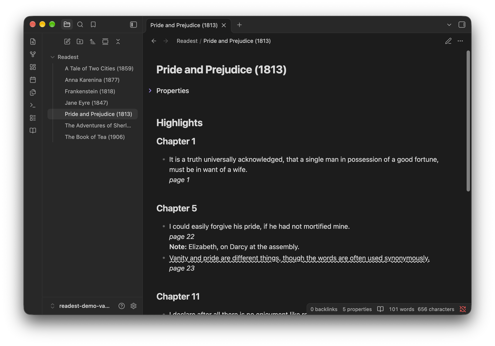

# Obsidian Readest Highlights

[Readest](https://readest.com) stores its library, progress, and annotations locally as JSON. This plugin reads those files and renders your highlights into your Obsidian vault, one note per book, where they can be searched and linked with the rest of your notes.

## Docs

- [Install](https://github.com/polybjorn/obsidian-readest-highlights/blob/main/docs/install.md)
- [Settings reference](https://github.com/polybjorn/obsidian-readest-highlights/blob/main/docs/settings.md)

## Commands

| Command | Action |
|---|---|
| Sync all books to folder | Creates or updates a note per book in the configured folder. |
| Sync one book to folder... | Pick a single book from a fuzzy picker. |
| Append one book to current note... | Pick a book, appends its highlights to the active note. |

## Requirements

Desktop Obsidian with access to a Readest Books folder. Readest's built-in sync is the easiest way to collect annotations from other devices into one folder, but any setup that exposes the folder to Obsidian works.

## What the plugin accesses

- **Readest folder, read-only.** The plugin reads `library.json`, each book's `config.json` and, if Cover folder is set, its `cover.png`, and never writes there. The folder is set in Settings, and if left empty the [platform default](https://github.com/polybjorn/obsidian-readest-highlights/blob/main/docs/settings.md#source) is used. Because this folder is outside the vault, the plugin uses Node's `fs` module to read it.
- **Vault, read and write.** On re-sync, the plugin matches books to existing notes in your output folder by their `readest-hash` frontmatter field, then creates or updates notes there. If Cover folder is set, it also copies each book's `cover.png` into that folder as an image; covers are never deleted.
- **No network.** The plugin makes no outbound requests.

## Disclaimer

Independent community plugin, not affiliated with Readest.
